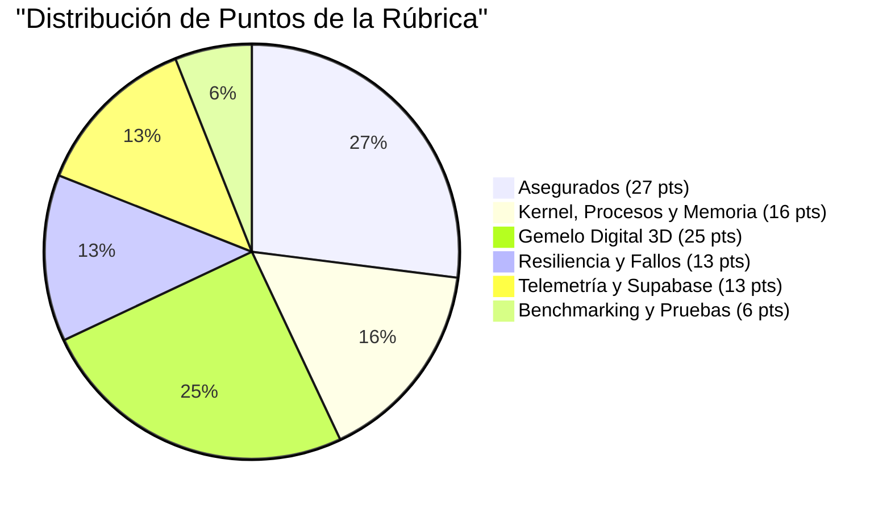
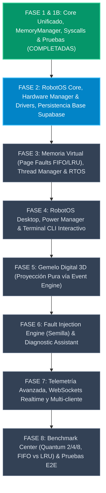

# AUDITORÍA ARQUITECTÓNICA INTEGRAL — ROBOTOS SMARTHOUSE
**Sistema Operativo Simulado de Robot Autónomo para Casa Inteligente**  
**Equipo:** Grupo 3 | **Fecha de Actualización:** 17 de Noviembre de 2026  
**Rol del Auditor:** Arquitecto de Software Senior en Sistemas Operativos, React, Supabase y Simulación Robótica  
**Estado General del Proyecto:** Fases 1 y 1B completadas exitosamente. Fases 2 a 8 congeladas esperando aprobación docente/usuario.

---

## 1. DESGLOSE EXHAUSTIVO DE LOS 73 PUNTOS EN RIESGO (RÚBRICA 100 PTS)

La rúbrica académica evalúa 5 dimensiones clave. Actualmente el proyecto cuenta con **27 puntos asegurados** y **73 puntos en riesgo crítico**. A continuación se detalla la justificación técnica de cada punto en riesgo y su estrategia de mitigación:

### Tabla de Desglose de Puntos en Riesgo

| Criterio de la Rúbrica | Pts Totales | Pts Asegurados | Pts en Riesgo | Subcomponentes Específicos en Riesgo |
|---|:---:|:---:|:---:|---|
| **1. Kernel, Procesos y Memoria** | **30** | **14** | **16** | • **6 pts**: Unificación del Scheduler (Prioridad / Round Robin) con ejecución real en React (completado en Fase 1/1B). • **5 pts**: Subsistema de Memoria Virtual (Page Table por proceso, Page Faults, Frame Allocation de 64 bloques y reemplazo FIFO vs LRU - Fase 3). • **5 pts**: Concurrencia, Thread Manager, IPC (colas de mensajes y buffer compartido) y primitivas de sincronización RTOS (Mutex/Semáforos - Fase 3). |
| **2. Sincronización con Gemelo Digital** | **25** | **0** | **25** | • **10 pts**: Renderizado espacial 3D interactivo de la casa (Salón, Cocina, Entrada, Exterior) y robot autónomo (Fase 5). • **8 pts**: Arquitectura de proyección pura vía Event Engine (sin estado propio, suscripción estricta al kernel/dispositivos - Fase 5). • **7 pts**: Matriz de reglas causa-efecto documentadas y medidor de latencia en tiempo real (<50 ms target - Fase 5). |
| **3. Resiliencia e Inyección de Fallos** | **20** | **7** | **13** | • **7 pts**: Fault Injection Engine determinista con semilla (PRNG), historial de fallos, fallos en cascada/combinados y auto-recuperación (Fase 6). • **6 pts**: Intelligent Diagnostic Assistant con cita explícita de evidencias (logs/telemetría) y estado "Datos Insuficientes" ante ambigüedad (Fase 6). |
| **4. Telemetría y Persistencia en Supabase** | **15** | **2** | **13** | • **4 pts**: Patrón `PersistenceAdapter` desacoplado (operación standalone offline + conexión limpia a Supabase - Fase 1B y 2). • **5 pts**: Acceso público anónimo sin login (visitante = solo lectura; solo ADMIN se autentica - Fase 1B y 2). • **4 pts**: Operaciones administrativas protegidas con Supabase Auth + RLS (`is_admin()`), historial de auditoría y WebSockets Realtime (Fase 2 y 7). |
| **5. Benchmarking y Pruebas** | **10** | **4** | **6** | • **4 pts**: Benchmark Center interactivo con comparativas cuantificadas (Round Robin quantum 2/4/8 vs Prioridad, FIFO vs LRU), reproducibilidad y persistencia (Fase 8). • **2 pts**: Cobertura de pruebas automatizadas en React y validación de transiciones de estado del sistema operativo (36 tests en Fase 1B, expandible en Fase 8). |
| **TOTAL** | **100** | **27** | **73** | **73 PUNTOS EN RIESGO RECUPERABLES MEDIANTE EL PLAN MAESTRO** |

---

## 2. ARQUITECTURA GENERAL Y REGLAS DE DISEÑO DEL SISTEMA

### Reglas Arquitectónicas Innegociables
1. **SystemContext como Consumidor de `src/core/` (Única Fuente de Verdad):** La lógica de procesos, memoria, reloj, syscalls y eventos reside exclusivamente en módulos JavaScript puros en `src/core/`. `SystemContext` solo los orquesta y proyecta a la interfaz de usuario.
2. **Capa Formal de Syscalls con Validación de Rol ADMIN:** Ninguna vista o componente de React muta el estado del Kernel directamente. Toda operación de creación/finalización de procesos, asignación de memoria o escritura en `/system` viaja por `syscalls.js`, donde se valida obligatoriamente el rol `ADMIN`.
3. **MemoryManager Canónico:** Gestión estricta de 1024 MB en 64 bloques de 16 MB. Los primeros 8 bloques (128 MB) están blindados permanentemente para el Kernel.
4. **Persistencia Base en Supabase en Fase 2:** El esquema relacional (`devices`, `security_events`, `user_roles`, `kernel_events`, `boot_history`) y las políticas RLS se integran tempranamente en la Fase 2 a través de `IPersistenceAdapter`.
5. **Hardware Manager y Drivers en Fase 2:** La capa de abstracción de hardware (HAL) para buses I2C, Zigbee y GPIO, junto con los drivers correspondientes en `/drivers`, se implementa íntegramente en la **Fase 2** (durante la etapa 6 de Boot `DRIVERS_LOAD`).
6. **Medición Real de Latencia:** La interfaz muestra la latencia local real medida (Kernel $\rightarrow$ Render UI, $\sim 1\text{ ms}$). Al no haber conexión activa a WebSockets de red, la latencia Realtime se declara explícitamente como `"NO CONECTADO (MODO LOCAL SIMULADO)"` sin falsear métricas.
7. **Modo Sandbox para Visitantes Anónimos:** Los usuarios sin credenciales de administrador operan en un entorno aislado volátil en memoria. Solo el `ADMIN` autenticado puede ejecutar operaciones persistentes compartidas.

---

## 3. PLAN MAESTRO REORDENADO Y CORREGIDO (FASES 1 A 8)

---

### FASE 1 & 1B: UNIFICACIÓN DEL CORE Y CIERRE DE CALIDAD (COMPLETADAS)
- **Estado:** ✅ **Completada y probada al 100% (36 tests pasados)**.
- **Entregables Logrados:**
  1. Rama `feature/fase1-core-unification` activa.
  2. Módulos JavaScript puros en `src/core/`: `clock.js`, `eventEngine.js`, `proceso.js`, `scheduler.js`, `cpu.js`, `memoryManager.js`, `bootManager.js`, `syscalls.js`, `IPersistenceAdapter.js`, `InMemoryPersistenceAdapter.js`.
  3. `MemoryManager`: 1024 MB en 64 bloques de 16 MB con 8 bloques protegidos de Kernel y asignación dinámica.
  4. Capa de Syscalls (`sys_create_process`, `sys_terminate_process`, `sys_allocate_memory`, `sys_free_memory`, `readFile`, `writeFile`, `deviceWrite`) con verificación estricta de rol ADMIN y emisión de eventos de seguridad.
  5. `BootManager`: 8 etapas canónicas completas con gestión de fallos y modo seguro.
  6. Resolución de duplicación: `procesos-cpu/` re-exporta directamente desde `src/core/`, manteniendo 16/16 tests verdes.
  7. Suite de 36 pruebas unitarias (`node --test test/core.test.js`) ejecutándose en $<200\text{ ms}$.
  8. Transparencia de latencia: latencia local medida en tiempo real y latencia Realtime declarada como no conectada.

---

### FASE 2: ROBOTOS CORE, HARDWARE MANAGER & DRIVERS, PERSISTENCIA BASE SUPABASE (CONGELADA)
- **Alcance Detallado:**
  1. **Hardware Manager y Drivers:**
     - Implementación de la capa HAL (Hardware Abstraction Layer) para simulación de buses I2C (sensores), Zigbee (cerraduras, clima) y GPIO (luces, actuadores).
     - Carga dinámica de controladores en la etapa 6 del Boot (`DRIVERS_LOAD`) montados en `/drivers` (`i2c_bus.ko`, `zigbee_mesh.ko`, `gpio_pins.ko`).
  2. **Persistencia Base de Supabase:**
     - Integración del esquema SQL (`001_security_tables.sql`) con tablas `devices`, `security_events`, `user_roles`, `kernel_events`, `boot_history`.
     - Implementación de `SupabasePersistenceAdapter` que extiende `IPersistenceAdapter`.
     - Políticas RLS: lectura pública anónima sin autenticación para telemetría y estado de dispositivos; mutaciones restringidas mediante función `public.is_admin()`.
  3. **Boot Manager en UI:**
     - Visualización interactiva de la secuencia de arranque en el Centro de Control y consola de diagnóstico.

---

### FASE 3: MEMORIA VIRTUAL, THREAD MANAGER & CONCURRENCIA RTOS (CONGELADA)
- **Alcance Detallado:**
  1. **Memoria Virtual con Page Faults:**
     - Tabla de Páginas por proceso y mapeo virtual-a-físico sobre los 64 bloques.
     - Simulación de Page Faults y algoritmos de reemplazo de páginas (**FIFO frente a LRU**).
  2. **Thread Manager e IPC:**
     - Soporte de hilos ligeros por proceso y colas de mensajes (Message Queues).
  3. **Communication Stack y RTOS:**
     - Primitivas `Mutex` y `Semaphore` para serialización de accesos concurrentes a buses compartidos con prevención de inversión de prioridad.

---

### FASE 4: ROBOTOS DESKTOP, POWER MANAGER & TERMINAL CLI (CONGELADA)
- **Alcance Detallado:**
  1. **Terminal CLI Interactivo:** Consola integrada en el Dashboard (`help`, `ps`, `kill`, `top`, `free`, `ls`, `cat`, `inject-fault`, `bench`, `reboot`).
  2. **Power Manager:** Balance energético, modelado de consumo dinámico por proceso y estado de carga AC/batería.
  3. **Experiencia de Acceso Público:** Navegación fluida para visitantes anónimos en modo solo lectura; inicio de sesión exclusivo para ADMIN.

---

### FASE 5: GEMELO DIGITAL 3D (PROYECCIÓN PURA) (CONGELADA)
- **Alcance Detallado:**
  1. **Renderizado Espacial 3D:** Representación tridimensional o isométrica de Salón, Cocina, Entrada, Exteriores y el robot autónomo.
  2. **Proyector Puro vía Event Engine:** El gemelo se suscribe a los eventos del Kernel sin estado propio y carga el estado actual al abrirse mediante `getSystemSnapshot()`.
  3. **Reglas Causa-Efecto y Medidor de Latencia:** Matriz documentada en UI y medidor en milisegundos de latencia de sincronización.

---

### FASE 6: RESILIENCIA, FAULT INJECTION & DIAGNOSTIC ASSISTANT (CONGELADA)
- **Alcance Detallado:**
  1. **Fault Injection Engine con Semilla:** Inyección reproducible de fallos combinados (pérdida Zigbee, fallo I2C, intrusión) con semilla determinista.
  2. **Intelligent Diagnostic Assistant:** Diagnóstico heurístico con citas textuales de eventos y estado obligatorio `"DATOS INSUFICIENTES"` ante información incompleta.
  3. **Rutinas de Auto-recuperación del Kernel:** Rollback y conmutación autónoma a modo seguro.

---

### FASE 7: TELEMETRÍA AVANZADA Y WEBSOCKETS REALTIME (CONGELADA)
- **Alcance Detallado:**
  1. Conexión de canales en tiempo real (`supabase.channel`) para sincronización multi-pantalla y multi-cliente.
  2. Medición real de latencia de red extremo a extremo (emisión cliente A $\rightarrow$ Supabase $\rightarrow$ recepción cliente B).

---

### FASE 8: BENCHMARK CENTER Y AUTOMATIZACIÓN DE PRUEBAS (CONGELADA)
- **Alcance Detallado:**
  1. **Centro de Benchmarks:** Comparativas cuantitativas de CPU (Round Robin quantum 2 vs 4 vs 8 vs Prioridad) y Memoria (FIFO vs LRU).
  2. **Suite E2E:** Automatización de pruebas de interfaz y validación de escenarios de laboratorio.

---

## 4. ESTADO DE APROBACIÓN POR FASES

| Fase | Título de la Fase | Estado de Autorización |
|---|---|:---:|
| **Fase 1 & 1B** | Core Unificado, MemoryManager, Syscalls, Pruebas y Cierre de Calidad | **COMPLETADA Y VERIFICADA (36/36 TESTS PASADOS)** |
| **Fases 2 a 8** | Core, Hardware Manager, Supabase Base, Memoria Virtual, Desktop, Gemelo 3D, Fallos, Benchmarks | **BLOQUEADAS — ESPERANDO APROBACIÓN** |
